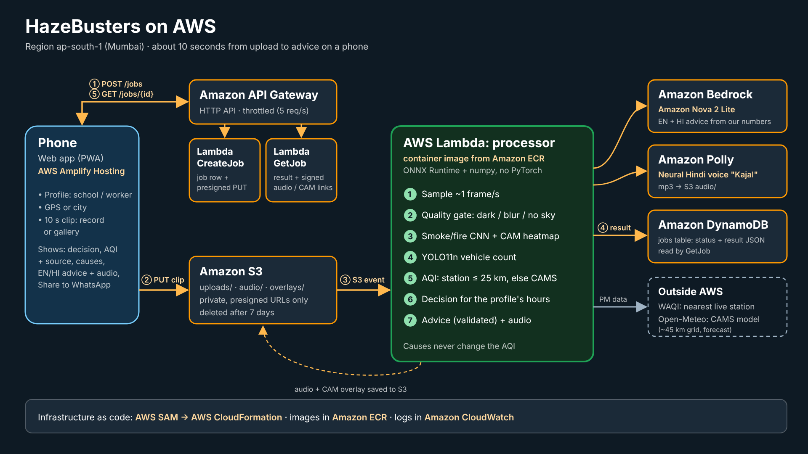

# My air-quality model scored 89%. On unseen days it lost to a constant guess.

*What one hackathon weekend taught me about honest ML, AWS serverless gotchas, and putting an LLM in front of a school. Built for WeMakeDevs × AWS Environmental Hacks (Air track).*

Here is the number that changed our whole project: **89%**.

That was our image model's accuracy at reading air quality from a dashcam photo. A phone camera that could estimate AQI anywhere was exactly the pitch we came to build.

Then we tested it on days the model had never seen. It scored **32%**. Always guessing the most common answer scores **47.5%**. The model wasn't seeing haze; it was memorising what each day looked like.

This post covers what we built instead, and everything that fought back along the way. Whether you do ML, AWS, LLM apps or just hackathons, there should be something here you can use on Monday.

**TL;DR**

- **Split your data by the thing that repeats** (day, place, camera, patient), never by row. A random split inflated our accuracy by about 30 points.
- **If you can't predict a number honestly, validate a source that already exists.** We checked the CAMS air-quality model against 59 ground stations and corrected its bias on purpose.
- **A 0.98 AP model can still fail in the real world.** Test it on another dataset and on your own data before you believe it.
- **On AWS:** presigned uploads, a SAM circular dependency, a 10-second Lambda init limit, Bedrock inference profiles and more. 12 gotchas with fixes below.
- **LLMs should phrase your numbers, not produce them.** Validate every output and keep a template fallback.

**Links:** [Live app](https://main.dxwuap9t49si3.amplifyapp.com) · [GitHub repo](https://github.com/ASR222/hazebusters) · [Demo video](VIDEO_LINK)

---

## Contents

1. The problem: no monitor where I live
2. What HazeBusters does, and what changes for a school
3. The model I almost shipped
4. Validate the source you have
5. Smoke detection: from 0.98 AP to "it's a hint"
6. The architecture on AWS
7. 12 AWS and production gotchas
8. Putting an LLM in front of a school
9. Building with several AI coding sessions at once
10. What I'd do differently
11. A checklist you can steal
12. A note to the WeMakeDevs builders

---

## 1. The problem: no monitor where I live

I study at BIT Mesra, near Ranchi. When I checked the World Air Quality Index (WAQI) for Ranchi, there was no station. In the 546-station India dataset we used, Jharkhand had exactly two official stations, Jamshedpur and Dhanbad, and none in Ranchi.

It got worse when I looked closer:

- **The nearest official station, Jamshedpur, is about 110 km from Ranchi, and it wasn't reporting to WAQI either** (we checked live on 11 Oct).
- **Hyderabad has 9 WAQI stations, and none of them had reported since June 2026.** A big city with a monitoring network can still have no live number.

So the question a school in Ranchi actually has, *"Can PE and assembly go outdoors today?"*, has no good answer. A national AQI map shows a colour; it doesn't tell you how far away that colour was measured, or what to do about it.

> **Takeaway:** before building, check what data actually exists where your users are. "Coverage" on a map is not the same as a live, nearby reading.

## 2. What HazeBusters does, and what changes for a school

A teacher picks a profile (School, Outdoor worker or General), films 10 seconds of the sky, and gets back, in about 10 seconds:

1. **A decision first:** "Outdoors OK until 5 PM", "Limit outdoor time" or "Avoid outdoors, no good window today". It's computed from the 3-hourly forecast over that profile's remaining hours (school 7 AM–5 PM).
2. **The AQI, and where it came from.** A WAQI station if one is within 25 km and under 3 hours old (high confidence). Otherwise the CAMS atmospheric model for that ~45 km grid cell (low confidence), with a caveat naming the nearest station and why it wasn't used.
3. **What's visible in the clip (experimental):** possible smoke or fire with a heatmap of where the model looked, plus a vehicle count.
4. **Advice in English and Hindi, with audio,** and a Share button that turns it into a WhatsApp message for the parents' group.

### What changes for the people living with it

We picked one small problem on purpose: **one decision, for one kind of user, every morning.**

| | Before | With HazeBusters |
|---|---|---|
| The number | A map colour from a station ~110 km away, or one that has stopped reporting | The nearest live reading if there is one, otherwise the model estimate for this area, labelled as such |
| Trust | No idea how far away or how old the number is | Source, distance, age and confidence on screen |
| The decision | Guess from the look of the sky | "Outdoors OK until 5 PM" or "No good window today", for school hours |
| Reaching parents | Type a message from scratch | One tap: a ready EN/HI message for the parents' WhatsApp group |

The same flow serves an **outdoor or gig worker** (6 AM–7 PM hours) and a general user.

To be honest about scope: we haven't piloted it with a school yet. That's the first next step (section 10).

### Built for where they are

The users are teachers and workers on mid-range Android phones, often on mobile data, many more comfortable in Hindi. Every UI choice came from that:

- **Nothing to install, no login.** It's a web page that opens from a shared link and can be added to the home screen.
- **The answer comes first.** The decision card is the first thing on screen, then the AQI, then the details. Caveats beyond the first one are folded under "Details".
- **Hindi text and Hindi audio**, so the advice works for someone who prefers to listen.
- **Location without friction.** GPS if allowed, a city list if not.
- **Two buttons, "Record clip" and "Choose from gallery".** On Android, the camera-capture input hides the gallery entirely, which we found on a real phone test.
- **It fails politely.** A clip that's too long gets a warning before upload. An indoor or dark clip gets "Couldn't check this clip. Point the camera at the sky or street outdoors", and every error has a Retry button.
- **Light on cheap phones and slow networks:**
  - plain HTML, CSS and JS, with no framework to download
  - the background image is 139 KB, and 27 KB on phones
  - the video goes straight to S3 instead of through our API
- **Readable outdoors.** Text contrast is checked to WCAG AA even over the brightest part of the sky background. Colour is never the only signal: every band has its name and number, and low confidence is amber, because red means "bad air".

> **Takeaway:** "usable" means usable *where your users are*. Test on the cheapest phone you can find, on mobile data, in the language they think in.

Notice what is *not* on that list: an AQI number estimated from the video. Here's why.

## 3. The model I almost shipped

**The plan:** fine-tune EfficientNet-B0 on TRAQID, an IIIT Hyderabad dataset of dashcam frames labelled with PM2.5 and PM10. Predict one of three CPCB-style AQI bands from a single image.

**The data:** 13,789 daytime front-camera frames. That sounds like a lot, until you notice they come from only **17 calendar days**, filmed every 5 seconds. Frames from the same drive look almost identical and share one AQI.

**The result:**

| Evaluation | Accuracy | "Always guess the majority band" |
|---|---|---|
| On the days it trained on | 89.0% | 47.2% |
| On 5 held-out days | **32.0%** | **47.5%** |
| Frozen features, random 5-fold over frames | 63.3% | 47.3% |
| Same features, leave-one-day-out | 33.5% | 33.7% |

Worse, it was **confidently wrong**: mean confidence 0.80 on the held-out days.

65% of the variation in AQI bands was *between* days, so the dataset really had about 17 independent samples, not 13,789. A random split puts frames from the same day in both train and test, and the model scores well by recognising the day: the light, the route, the weather. Many published image-to-AQI results use random splits.

I also tested on a second dataset (India/Nepal, 8 locations) with leave-one-city-out. The predictions came out *inverted*: clean cities were called polluted and vice versa, because each city was nearly one band and the model had learned the city.

**What we did:** dropped image-to-AQI from the product, wrote the negative result up properly, and moved on to something we could defend.

> **Takeaway:** split by whatever repeats: day, location, camera, patient, user. In scikit-learn that's one line:
>
> ```python
> from sklearn.model_selection import GroupKFold
> for train_idx, test_idx in GroupKFold(n_splits=5).split(X, y, groups=df["date"]):
>     ...
> ```
>
> And always report the majority-class baseline next to your accuracy. 89% means nothing without it.

## 4. Validate the source you have

If the camera can't measure AQI, where does the number come from where there's no station? **CAMS**, the Copernicus atmospheric model, available free through the Open-Meteo API at about 45 km resolution.

A model value isn't a measurement, so we checked it. Two years (2023–24) of daily PM2.5, CAMS against ground stations in three cities:

| City | Stations | Same band (raw CAMS) | Very Poor/Severe days caught (raw → ×1.25) |
|---|---|---|---|
| Delhi | 43 | 56.2% | 67 → 125 of 201 |
| Patna | 4 | 62.5% | 46 → 80 of 133 |
| Hyderabad | 12 | 94.8% | 0 of 2 |

What we found:

- **CAMS follows the ups and downs well** (correlation 0.71–0.79), but reads about **0.8× the stations**. It **missed about two thirds of the worst days** in Delhi and Patna.
- **For a school, missing a severe day is worse than an extra cautious one.** So when we fall back to CAMS, we scale PM by ×1.25. That nearly doubles the bad days caught in Delhi (67 → 125).
- **It has a cost, and we show it.** In clean Hyderabad, band agreement drops from 94.8% to 86.3%, because borderline days tip into "limit". The factor was also picked from these same three cities, so these numbers flatter it. All of this is in the app's caveat text and in our writeup.

> **Takeaway:** when an error costs more in one direction, bias your system on purpose, then disclose the trade-off. And watch base rates: Hyderabad's 94.8% is mostly "almost every day is clean", not skill.

## 5. Smoke detection: from 0.98 AP to "it's a hint"

The camera's honest job is **explaining causes**: is something visibly burning nearby?

We trained EfficientNet-B0 with two sigmoid outputs (smoke, fire) on **D-Fire** (21,527 images, CC0). We grouped near-duplicate images with perceptual hashes so they couldn't leak across splits.

**In-domain test:** AP 0.979 (smoke), 0.982 (fire). Looks done.

**External test on Pyro-SDIS** (wildfire cameras): smoke recall **13.4%**, false-positive rate **20.5%**. The AP (0.845) was *below the 0.868 base rate*, meaning worse than random ranking. We ran a diagnosis:

- **Not a threshold problem:** at every threshold, recall roughly equalled the false-positive rate.
- **Not mainly resolution:** at 448 px the AP only reached chance level.
- **A second split leak:** Pyro-SDIS's own validation set shares 83 of its 84 cameras with training.

**Then the test that mattered: real clips.** 23 ten-second clips: 15 we filmed on phones around campus, plus 8 free stock clips for fire and smoke we couldn't safely film ourselves. We report them separately:

| At threshold 0.60 | Our own clips | Stock clips | All |
|---|---|---|---|
| Smoke clips flagged | 5 of 5 | 1 of 2 | 6 of 7 |
| Fire clips flagged | — | 2 of 2 | 2 of 2 |
| No-smoke clips wrongly flagged | **4 of 9** | 1 of 4 | **5 of 13** |
| Indoor clip rejected by the quality gate | 1 of 1 | — | 1 of 1 |

(One duplicated clip is excluded.)

We tried three fixes: a hard-negative fine-tune, suppressing detections on bright sun glare, and requiring 50% of frames to agree. None removed the false alarms without losing a real smoke hit. The false alarms score 0.96–1.0, and the heatmap sits on **ordinary urban haze**. No threshold fixes that; it needs training data with Indian city haze as a negative.

So the product says exactly what we know:

- **The card is labelled "experimental"** and shows "Possible (model score xx%)", never "Detected".
- **It prints the 6/7 and 5/13 numbers** right under it.
- **The advice line is conditional:** *"Our camera check suggests possible smoke in your clip (experimental). If you can see a smoke source nearby, move away from it."* It's true whether the model is right or wrong.

**Two things that made this cheap to run on Lambda:**

- **No PyTorch at runtime.** The model is exported to ONNX with two outputs, the final 1280×7×7 feature map and the logits.
- **The heatmap is plain CAM in numpy.** For a global-average-pool plus linear head, the class activation map is just the classifier weights times the feature map. No gradients needed, and it matches the ONNX logits to within 6e-6.

```python
# features: (1280, 7, 7) from ONNX, W: (2, 1280) classifier weights (simplified)
cam = np.tensordot(W[label], features, axes=1)       # (7, 7)
cam = np.maximum(cam, 0) / (cam.max() + 1e-6)         # then upsample onto the frame
```

**Vehicles** come from pretrained YOLO11n (COCO classes car, motorcycle, bus, truck), also in ONNX. We wrote our own numpy post-processing and checked it matches Ultralytics' counts exactly on 20 test frames. The clip's count is the median over frames.

**A quality gate runs first.** It rejects frames that are too dark, blurred (sharpness measured per tile, because plain sky has no texture), or have no sky in the top 40%. Fewer than 3 good frames means we skip the cause models and say so. It's rule-based, so a bright white room can still pass as overcast sky. That's listed as a known limitation.

> **Takeaway:** test on a dataset you didn't train on, then on data you collected yourself. When the evidence says "hint", the UI should say "hint".

## 6. The architecture on AWS



Everything runs in **ap-south-1 (Mumbai)**, deployed with **AWS SAM**:

1. **Amplify Hosting** serves the PWA: plain HTML, CSS and JS, no framework, no build step.
2. **API Gateway (HTTP API) → CreateJob Lambda:** validates location and profile, writes a `pending` row to **DynamoDB**, and returns a **presigned S3 PUT URL**.
3. The phone uploads the clip **straight to S3**, so the video never passes through API Gateway.
4. The **S3 event** triggers the **processor Lambda**, a container image on ECR (Python 3.12, 3 GB memory, ONNX Runtime, about 1.26 GB):
   - samples ~1 frame/s → quality gate → smoke/fire model + CAM → YOLO vehicle count
   - fetches WAQI and CAMS, picks the source, computes the decision
   - **Amazon Bedrock** (Amazon Nova 2 Lite) writes the EN/HI advice
   - **Amazon Polly** (neural Hindi voice "Kajal", plus English) reads it aloud, saved to S3
   - writes the result to DynamoDB
5. The phone polls **GetJob**, which returns the result plus presigned links to the audio and heatmap.

Upload to result takes about 10 seconds on a phone. The warm processor run is 5–6 s, and Bedrock takes about 1–1.5 s of that.

> **Takeaway:** write the result contract first. We kept a `contract.json` with every field the frontend would read. ML, backend and frontend were built against it in parallel, and integration took minutes instead of an evening.

## 7. 12 AWS and production gotchas

Every one of these cost us time. Each comes with the fix.

**1. Presigned S3 uploads failing CORS.** Sign the URL with the *same* `Content-Type` the browser will send. Outside us-east-1, also force SigV4 with virtual-host addressing, or new buckets can redirect and break CORS.

```python
s3 = boto3.client("s3", region_name=REGION,
                  config=Config(signature_version="s3v4", s3={"addressing_style": "virtual"}))
url = s3.generate_presigned_url("put_object", ExpiresIn=300,
          Params={"Bucket": BUCKET, "Key": key, "ContentType": content_type})
```

**2. SAM "circular dependency" between the bucket, its event notification and the function's policy.** Give the bucket an explicit name, e.g. `!Sub "${AWS::StackName}-uploads-${AWS::AccountId}"`, and reference that *string* in the policy instead of `!Ref`.

**3. DynamoDB rejects Python floats.** We store the whole result as a JSON string (`result_json`). It's simpler than converting everything to `Decimal`.

**4. Lambda's 10-second init limit.** Loading two ONNX models at cold start pushed init past 10 s. Lambda then reran the init inside the invocation, and a job took 13 s. Loading lazily on the first request brought init down to 1.3 s:

```python
_session = None
def session():
    global _session
    if _session is None:
        _session = ort.InferenceSession(MODEL_PATH, providers=["CPUExecutionProvider"])
    return _session
```

**5. Keep PyTorch out of Lambda.** ONNX Runtime plus numpy covers inference *and* the heatmap (section 5).

**6. Bedrock model access isn't just a checkbox.** Anthropic models needed an AWS Marketplace subscription permission our IAM user didn't have, so we used **Amazon Nova 2 Lite**. It must be called through an **inference profile** ID (`global.amazon.nova-2-lite-v1:0`); the bare model ID fails.

**7. New accounts can have a Lambda concurrency limit of 10.** Ours did, and it can't be raised through Service Quotas below 1,000. We throttled the API (burst 10, 5 requests/s) so a burst can't starve the processor.

**8. Lambda runs in UTC; your users don't.** Our forecast was correctly in IST, but two fallback paths silently used UTC. At 6 PM IST, one of them would have said "today" instead of "tomorrow". Test with a UTC "now" on purpose.

**9. Read third-party error messages literally.** WAQI's `"can not connect"` for a location doesn't mean "no station". It also happens when stations exist but are offline. We added a bundled index of official stations, so the caveat can say *"the nearest station, X km away, last reported 109 days ago"* instead of guessing.

**10. External APIs time out exactly when you demo.** One Open-Meteo call took over 10 s and a job failed. One retry plus logging fixed it.

**11. Service workers cache yesterday's bug.** Use network-first for your own files, never intercept API or S3 requests, and bump a cache version on every deploy.

**12. Amplify manual deploys can get stuck at "Deploy pending"** if the upload didn't finish, and every later deploy queues behind it. Stop the stuck jobs and deploy from the CLI: `aws amplify create-deployment`, upload the zip to the returned URL, then `aws amplify start-deployment`.

## 8. Putting an LLM in front of a school

The advice is the most human part of the app and the riskiest. A model that writes "the air is safe" with a made-up number, or states smoke as fact, is worse than no advice. Our rules:

- **The LLM only phrases numbers we computed.** It gets the AQI, band, decision and profile, and is asked for JSON with `en` and `hi`.
- **Every response is validated before use:**
  - it must be JSON, with both languages present
  - the Hindi must actually be in Devanagari
  - the AQI must appear, and **no number may appear that we didn't provide**
  - it must fit a sentence budget
  - the Hindi health sentences must avoid definite-future phrasing
- **Anything that fails falls back to a template,** and `advice.source` records which one was used.
- **The smoke line is added by code, not the LLM.** Nova kept leaving smoke out when we asked it to include it. The model never sees the smoke result now, and any smoke wording in its output is rejected.

> **Takeaway:** treat LLM output like user input. Validate it, have a fallback, and keep safety-critical sentences in code.

## 9. Building with several AI coding sessions at once

For most of the weekend I was the only one building. I ran **three Claude Code sessions in separate git worktrees**: ML, infra and web, each on its own branch. A separate Claude chat acted as planner and reviewer, writing each session's next prompt and checking its report. What worked:

- **Worktrees, not branches in one folder.** Three agents can't safely share one working directory.
- **One shared `CLAUDE.md`** with the rules: never commit data or secrets, CPCB AQI table, decisions and current status. Every session read it first.
- **"Only report numbers read from files on disk."** Early on, a session reported training metrics for a run that never happened. After this rule every number in this post came from a file in `ml/runs/`.
- **Small PRs with merge commits**, merged at sync points.

We list every AI tool we used in the writeup, as the rules require.

> **Takeaway:** AI sessions are fast but confidently wrong in the same way our 89% model was. Make them show their evidence.

## 10. What I'd do differently

- **Collect our own data on day one.** Our handful of phone clips taught us more about the smoke model than two public datasets did.
- **Run the leakage check before training, not after.** Count unique days, places and cameras first.
- **Pick the hero user before the model.** "Can PE go outdoors?" shaped every decision, and the image-to-AQI idea didn't serve it.

**What's next:** first, put it in front of two or three teachers near campus and watch them use it without help. Then the data flywheel: every clip filmed near a live station is a labelled example, so the app can collect the honest dataset that image-to-AQI was missing. We also want a daily 6:30 AM alert for schools and more Indian languages.

## 11. A checklist you can steal

- [ ] Majority-class baseline next to every accuracy number
- [ ] Split by group (day, place, camera, user), never by row
- [ ] An external test set you didn't train on, plus your own real-world data
- [ ] Validate any third-party data source against ground truth before you trust it
- [ ] Bias on purpose when errors are asymmetric, and disclose it
- [ ] UI wording matches the evidence ("possible", "experimental", "low confidence")
- [ ] LLM output validated, with a template fallback; safety-critical text written in code
- [ ] API contract written first
- [ ] Lambda: lazy-load models, no torch, check your account's concurrency limit
- [ ] Presigned uploads: same Content-Type, SigV4, virtual addressing
- [ ] Test timezones with a UTC clock

---

## 12. A note to the WeMakeDevs builders

If you're building for a hackathon right now, here's what I wish someone had told me on day one:

- **Your most impressive result might be a bug.** Before you celebrate a number, ask what your model could be memorising instead.
- **A negative result is a result.** "We tried X, and here's the proof it doesn't work" taught us more than anything that worked, and it's a better story than a number nobody can trust.
- **Ship the honest version.** "Possible smoke (experimental)" is less exciting than "Smoke detected", but it's the one you can defend in front of a judge, a teacher or a parent.
- **Small and finished beats big and almost.** We cut image-to-AQI, report-burning drafts and a custom smoke detector, and the app got better each time.
- **Use the tools, but check their work.** AI coding assistants built a lot of this with me. They were most useful once every claim had to point to a file.

If you're in a place with no monitor, **try the app and tell us what breaks.** If you want to help build the honest dataset, a 10-second clip filmed near a live station is exactly the data that's missing. Issues and PRs are welcome on the repo.

See you at the next one.

---

**Try it:** [main.dxwuap9t49si3.amplifyapp.com](https://main.dxwuap9t49si3.amplifyapp.com) · **Code (AGPL-3.0):** [github.com/ASR222/hazebusters](https://github.com/ASR222/hazebusters) · **Video:** [VIDEO_LINK](VIDEO_LINK)

**Credits:**

- **Data:** TRAQID (Kathalkar et al., ICVGIP 2024); India/Nepal air pollution images (Utomo et al.); D-Fire (CC0); Pyro-SDIS (Apache-2.0); India AQI stations dataset (CC BY-SA 4.0); CAMS via Open-Meteo; WAQI.
- **Models:** Ultralytics YOLO11n (AGPL-3.0).
- **AWS:** Amazon S3, AWS Lambda (container image via Amazon ECR), Amazon API Gateway (HTTP API), Amazon DynamoDB, AWS Amplify Hosting, AWS SAM / AWS CloudFormation and Amazon CloudWatch, all in ap-south-1 (Mumbai).
- **AWS AI models:** Amazon Nova 2 Lite on Amazon Bedrock (advice text in English and Hindi, via the Converse API) and Amazon Polly neural text-to-speech (Hindi voice "Kajal", plus English).
- **Event:** WeMakeDevs × AWS Environmental Hacks (Bharat Builds Tour), thanks to the organisers and mentors.
- **AI tools used:** Antigravity and Claude.

*Built by Abhay for WeMakeDevs × AWS Environmental Hacks 2026, Air track.*
